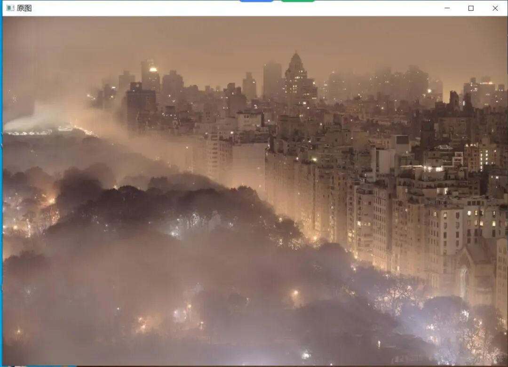
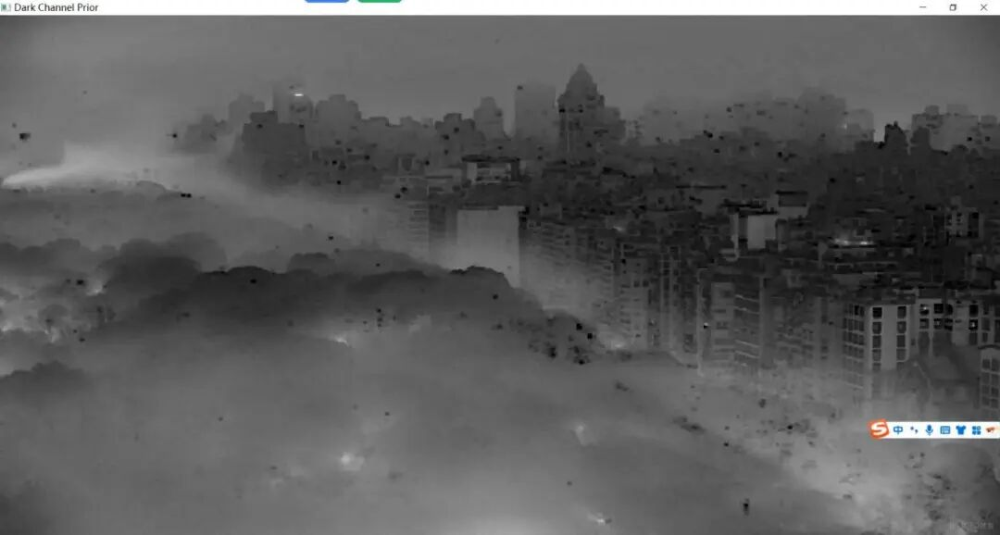
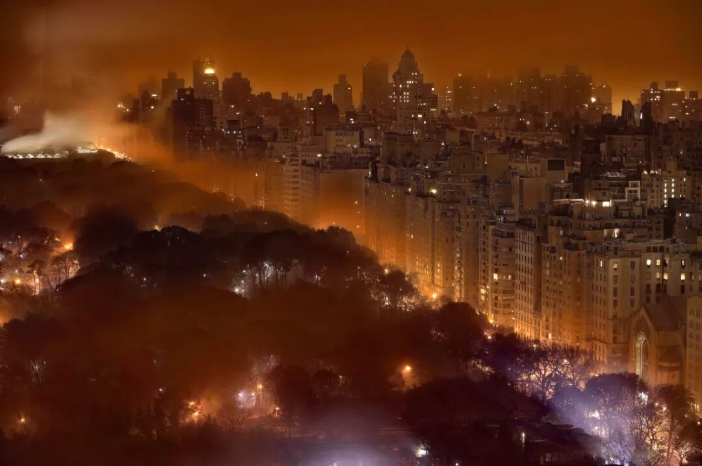

# Dark Channel Prior-based Image Dehazing with OpenCV in C++

Test Environment: VS2019, OpenCV==4.9.0, Supports OpenCV3.4 and above.

## Test Environment: VS2019, OpenCV==4.9.0, Supports OpenCV3.4 and above versions.

### Preface

Currently, there are many image dehazing algorithms, and the general approach is basically two:

-

1. Based on non-physical models, it essentially enhances the contrast and color of images without analyzing the formation reasons of fog-affected images for compensation. The representative method is histogram equalization. The effect is generally average.

-

2. Based on physical models, the current effective dehazing algorithms are all based on physical models, utilizing atmospheric physics scattering principles to establish image restoration models. The models used by different papers vary. Algorithms based on physical models can better analyze hazy images due to their closer adherence to reality and generally perform well. However, the differences in algorithm complexity and computational time are merely minor. Representative methods include Dr. He Keming's Single Image Haze Removal Using Dark Channel Prior, which is based on the dark channel prior dehazing algorithm. Currently, the one that seems to perform the best is the dark channel prior dehazing algorithm.

#[#Single] Image Haze Removal Using Dark Channel Prior in the Dehazing Algorithm, utilizing the following physical model:![Insert image description here][2] In which I(x) represents the image after haze, J(x) represents the unhaze image, A is the global atmospheric illumination value, and t(x) is the transmittance map.

The equation simplifies to: [3] This essentially means that given I(x), we can then analyze I(x) to determine J(x).

#[# Dark Channel] First, let's understand what a dark channel is. In the paper by [Author], the definition of a dark channel is: in an image without fog, some pixels in most local areas will have very low pixel values (in other words, that is, all pixels in a certain region have a minimum value of their channels very small (0~16)). The generation of these pixel values is mainly due to shadows (shadow), colorful objects (colorful object) (the value of one channel is too large, causing the values of other channels to be small), and black objects, etc. In the case of images with fog, because of the presence of fog, the dark channel is not entirely black; as shown in the following figure: ![][4] It can be seen that the upper part with fog is whiter, while the lower urban area is mostly black. Thus, we can use the dark channel to determine whether there is fog in the image and its concentration. This conclusion was drawn after analyzing many images, so it is considered a priori.

The calculation method for the dark channel is also very easy![][5]

In which Ω is a square area, i.e., the pixel value that calculates the minimum value of each channel within an area is taken as the dark channel value for each pixel.

#[#Global Atmospheric Lighting Value] Since the global atmospheric lighting value is needed for calculating transmittance maps, it's necessary to first calculate A. The calculation method for A is quite simple.

>

the pixels with highest intensity in the input image I is selected as the atmopheric light.

This is the method provided in the text, selecting the brightest 0.1% of pixels in the dark channel, then identifying the pixel with the highest brightness in the original image as A.

# Transmittance Calculations: The following formulas are used for transmittance calculations: ![][6]

Among them, w is a parameter introduced to prevent image distortion by controlling the proportion of fog retention. If only this approach is taken, due to the calculation method of transmittance map, which is calculated in each region, the transmittance map will be divided into blocks. Therefore, we also need to process the transmittance map to calculate a fine transmittance map. In the original paper, the soft-clamping algorithm used was very slow.

#[#Dehazing] We have now calculated A, t(x), I(x), and can proceed with dehazing.

As per the formula: ![][7]

In which t0 is to prevent the values in t(x) from being zero and to prevent t(x) from going too low, which would cause J(x) to be too large, leading to an image that is overly white.

[#Improvement]

-

In the original algorithm, the calculation of the fine transmission rate map was performed using a soft-trapezoidal method. However, I have switched to the directional filtering used in the same paper published by Dr. He. Directional filtering is a fast filtering algorithm and interested readers can refer to the paper for more details. Currently, MATLAB and OpenCV have integrated this filtering algorithm. It was not available when I wrote this, so I implemented it myself. In fact, Dr. He's paper on directional filtering is very clear about its usage, so I highly recommend everyone to read it.

-

The algorithm's performance for sky computation is not very good, especially when there is fog, which can cause the sky to appear unnaturally. Here, I have adopted a simple method to improve it: introduce a parameter K. If the global atmospheric light value A is less than the absolute value of the corresponding dark channel value, divide this absolute value by K and multiply by K. If it is greater than, then leave it unchanged.

A small parameter can be added to the final calculation to increase the brightness of the image, as the dehazed image tends to be darker. The images in He's paper have been processed again.

The value of A can be taken as the average of three channels, or as the average of the first 0.1% of the data. It can also be taken both ways.

When calculating the time of directional filtering, either the original image or its grayscale version can be used. However, using the original image will be slower because it involves three channels to calculate.

There are actually some areas for improvement, but they're all things that could be said or left unsaid, and it feels like everyone has already covered the same ground.

By the way, Dr. He has just written another paper on a recent improvement to directional filtering, called Fast Directional Filtering. It's amazing that someone is writing yet another paper on this topic: using Fast Directional Filtering for dehazing.

#[Reflection] There are still many filtering algorithms, but they generally cannot fit this framework. Moreover, I have not read many papers myself and have also written some. I feel that this algorithm is relatively stable, optimized, and works well on any image with good results, and it is fast and can be used for video processing.

In fact, many domestic articles are currently optimizing this algorithm. The ideas are mostly focused on the optimization of transmission rate graphs, computational speed, and dehazing effects, etc. For example, using other filtering methods to limit the values of t(x), etc. There are various methods, and their effects are quite good. However, the speed should not be too fast, which is the difference between academia and industry.

While referencing another blog, I discovered an algorithm for dehazing with a time complexity of O(1). After reviewing it, I found that its effectiveness was not as good as the one mentioned, despite its speed. Specifically, see: [A Real-Time Processing Algorithm for Dehazing with O(1) Time Complexity][16]. Another algorithm with better results was also written by a distinguished expert: [Optimized Contrast Enhancement Algorithm for Clear Image Processing in Foggy Conditions][17].

### Code

```
[#define] _CRT_SECURE_NO_WARNINGS
[#include] "main.h"
[#include] "guidedfilter.h"
using namespace std;
using namespace cv;
int _PriorSize = 15; //Window size
double _topbright = 0.001;//The highest brightness ratio of the pixels.
double _w = 0.95;			//w
float t0 = 0.1; // The minimum value of T(x) because we cannot have tx less than 0, equal to 0, which is not effective.
int SizeH = 0; //Image height
int SizeW = 0; //Image width
int SizeH_W = 0; // The total number of pixels in the image, H*W
Vec<float, 3> a;//Global atmospheric light value
Mat trans_refine;
Mat dark_out1;
char img_name[100] = "ny_night.jpg";//File name
//Read in the image
Mat ReadImage()
{
	Mat img = imread(img_name);
	SizeH = img.rows;
	SizeW = img.cols;
	SizeH_W = img.rows*img.cols;
	Mat real_img(img.rows, img.cols, CV_32FC3);
	img.convertTo(real_img, CV_32FC3);
	real_img = real_img / 255;
	return real_img;
//Read in an image and convert it into a 3-channel matrix.
//Divide by 255 to ensure the RBG values are between 0 and 1.
}
// Calculate the dark channel
//J^{dark}(x)=min( min( J^c(y) ) )
Mat DarkChannelPrior(Mat img)
{
Mat dark = Mat::zeros(img.rows, img.cols, CV_32FC1); // Create a single-channel matrix with all elements set to 0.
	for (int i = 0; i(i, j) = min(
				min(img.at<Vec<float, 3>>(i, j)[0], img.at<Vec<float, 3>>(i, j)[1]),
				min(img.at<Vec<float, 3>>(i, j)[0], img.at<Vec<float, 3>>(i, j)[2])
);//This is the process of two minimum values.
		}
	}
erode(dark, dark_out1, Mat::ones(_PriorSize, _PriorSize, CV_32FC1)); // This function is called "erosion," which performs template operation with a window size and corresponds to minimum filtering, i.e., the block of black pixels in the image.
return dark_out1; // Here, dark_out1 is a global variable because it will also be used elsewhere.
}
Mat DarkChannelPrior_(Mat img)//This function is used in the calculation of tx, because it involves a process similar to calculating the dark channel, which involves finding the minimum value. The changes are minimal, so I've modified it and used it here.
{
double A = (a[0] + a[1] + a[2]) / 3.0;//Global atmospheric light value, here is the average of three channels
	Mat dark = Mat::zeros(img.rows, img.cols, CV_32FC1);
	Mat dark_out = Mat::zeros(img.rows, img.cols, CV_32FC1);
	for (int i = 0; i(i, j) = min(
				min(img.at<Vec<float, 3>>(i, j)[0] / A, img.at<Vec<float, 3>>(i, j)[1] / A),
				min(img.at<Vec<float, 3>>(i, j)[0] / A, img.at<Vec<float, 3>>(i, j)[2] / A)
);// Similarly,
		}
	}
erode(dark, dark_out, Mat::ones(_PriorSize, _PriorSize, CV_32FC1));//Same as above
	return dark_out;
}
//Calculate A's value
Vec<float, 3> Airlight(Mat img, Mat dark)//vec<float ,3> indicates a vector of three sizes, type float
{
	int n_bright = _topbright*SizeH_W;
Mat dark_1 = dark.reshape(1, SizeH_W); // Here, dark_1 is a matrix with the same number of rows as the image pixels, which is convenient for the following loop calculations.
	vector<int> max_idx;
	float max_num = 0;
	Vec<float, 3> A(0, 0, 0);
	Mat RGBPixcels = Mat::ones(n_bright, 1, CV_32FC3);
	for (int i = 0; i<n_bright; i++)
	{
		max_num = 0;
		max_idx.push_back(max_num);
		for (float * p = (float *)dark_1.datastart; p != (float *)dark_1.dataend; p++)
		{
			if (*p>max_num)
			{
max_num = *p;//record the maximum value of illumination
max_idx[i] = (p - (float *)dark_1.datastart);//position
RGBPixcels.at<Vec<float, 3>>(i, 0) = ((Vec<float, 3> *)img.data)[max_idx[i]]; //Assign the values of the three corresponding channels to RGBPixels.
			}
		}
((float *)dark_1.data)[max_idx[i]] = 0;//Marks that have been visited are set to 0, so they won't be accessed again.
	}
	for (int j = 0; j<n_bright; j++)
	{
		A[0] += RGBPixcels.at<Vec<float, 3>>(j, 0)[0];
		A[1] += RGBPixcels.at<Vec<float, 3>>(j, 0)[1];
		A[2] += RGBPixcels.at<Vec<float, 3>>(j, 0)[2];
}//Accumulate the light value.
	A[0] /= n_bright;
	A[1] /= n_bright;
A[2] /= n_bright; //Divide by the total number, which means taking the average of all points that meet the criteria.
	return A;
}
//Calculate Transmission Matrix
Mat TransmissionMat(Mat dark)
{
	double A = (a[0] + a[1] + a[2]) / 3.0;
	for (int i = 0; i < dark.rows; i++)
	{
		for (int j = 0; j < dark.cols; j++)
		{
			double temp = (dark_out1.at<float>(i, j));
			double B = fabs(A - temp);
			//	conut++;
			//cout << conut << endl;
			//if (B==)
if (B - 0.3137254901960784 < 0.0000000000001) // K = 80
			{
				dark.at<float>(i, j) = (1 - _w*dark.at<float>(i, j))*
(0.3137254901960784 / (B)); // This is the modified part of the equation.
			}
			else
			{
				dark.at<float>(i, j) = 1 - _w*dark.at<float>(i, j);
			}
if (dark.at<float>(i, j) <= 0.2)//Ensure Tx does not distort, as the result above division will be incorrect.
			{
				dark.at<float>(i, j) = 0.5;
			}
if (dark.at<float>(i, j) >= 1)//Same as above
			{
				dark.at<float>(i, j) = 1.0;
			}
		}
	}
	return dark;
}
Mat TransmissionMat1(Mat dark)
{
	double A = (a[0] + a[1] + a[2]) / 3.0;
	for (int i = 0; i < dark.rows; i++)
	{
		for (int j = 0; j < dark.cols; j++)
		{
			dark.at<float>(i, j) = (1 - _w*dark.at<float>(i, j));
		}
	}
	return dark;
}
//Calculate Haze Free Image
Mat hazefree(Mat img, Mat t, Vec<float, 3> a, float exposure = 0)//The value of exposure here represents the brightness adjustment after dehazing.
{
	double AAA = a[0];
	if (a[1] > AAA)
		AAA = a[1];
	if (a[2] > AAA)
		AAA = a[2];
//Get the maximum value from a
//Create a new matrix.
	Mat freeimg = Mat::zeros(SizeH, SizeW, CV_32FC3);
	img.copyTo(freeimg);
//Two iterators, this way of writing can avoid two nested loops, which is relatively faster.
	Vec<float, 3> * p = (Vec<float, 3> *)freeimg.datastart;
	float * q = (float *)t.datastart;
	for (; p<(Vec<float, 3> *)freeimg.dataend && q<(float *)t.dataend; p++, q++)
	{
		(*p)[0] = ((*p)[0] - AAA) / std::max(*q, t0) + AAA + exposure;
		(*p)[1] = ((*p)[1] - AAA) / std::max(*q, t0) + AAA + exposure;
		(*p)[2] = ((*p)[2] - AAA) / std::max(*q, t0) + AAA + exposure;
	}
	return freeimg;
}
void printMatInfo(char * name, Mat m)
{
	cout << name << ":" << endl;
	cout << "\t" << "cols=" << m.cols << endl;
	cout << "\t" << "rows=" << m.rows << endl;
	cout << "\t" << "channels=" << m.channels() << endl;
}
//Main Function
int main(int argc, char * argv[])
{
	Mat dark_channel;
	Mat trans;
	Mat img;
	Mat free_img;
	char filename[100];
while (_access(img_name, 0) != 0)//Check if the image exists
	{
		std::cout << "The image " << img_name << " don't exist." << endl << "Please enter another one:" << endl;
		cin >> filename;
	}
	clock_t start, finish;
	double duration1, duration3, duration4, duration7;
//Read in the image
cout << "Reading in image..." << endl;
	start = clock();
	img = ReadImage();
cv::namedWindow("Original Image", cv::WINDOW_KEEPRATIO);
imshow("Original Image", img);
	//printMatInfo("img", img);
	finish = clock();
	duration1 = (double)(finish - start) / CLOCKS_PER_SEC;
cout << "Time Cost: " << duration1 << "s" << endl;//Output this step's time
	cout << endl;
// Calculate the dark channel
cout << "Calculating dark channel ..." << endl;
	start = clock();
	dark_channel = DarkChannelPrior(img);
	cv::namedWindow("Dark Channel Prior", cv::WINDOW_KEEPRATIO);
	imshow("Dark Channel Prior", dark_channel);
	printMatInfo("dark_channel", dark_channel);
	finish = clock();
	duration3 = (double)(finish - start) / CLOCKS_PER_SEC;
	cout << "Time Cost: " << duration3 << "s" << endl;
	cout << endl;
//Calculate global illumination value
cout << "Calculating A value ..." << endl;
	start = clock();
	a = Airlight(img, dark_channel);
	cout << "Airlight:\t" << " B:" << a[0] << " G:" << a[1] << " R:" << a[2] << endl;
	finish = clock();
	duration4 = (double)(finish - start) / CLOCKS_PER_SEC;
	cout << "Time Cost: " << duration4 << "s" << endl;
	cout << endl;
//Calculate tx
	cout << "Reading Refine Transmission..." << endl;
	trans_refine = TransmissionMat(DarkChannelPrior_(ReadImage()));
	//printMatInfo("trans_refine", trans_refine);
	//imshow("Refined Transmission Mat",trans_refine);
	cout << endl;
Mat tran = guidedFilter(img, trans_refine, 60, 0.0001); // Guided filtering to obtain a fine transmission rate map
														   //imshow("fitler", tran);
//Dew removal
	cout << "Calculating Haze Free Image ..." << endl;
	start = clock();
free_img = hazefree(img, tran, a, 0);//if using tran, it refers to the directional filtering part.
//If it's trans_refine, there is no use of directional filtering, and the effect is not so good.
										 /*
The fourth parameter above is used to increase brightness, and 0.1 is a good value.
	cv::namedWindow("After the fog clears",cv::WINDOW_KEEPRATIO);								 */
imshow("After fog removal", free_img);
	finish = clock();
	duration7 = (double)(finish - start) / CLOCKS_PER_SEC;
	cout << "Time Cost: " << duration7 << "s" << endl;
	cout << "Total Time Cost: " << duration1 + duration3 + duration4 + duration7 << "s" << endl;
//Save image code
	imwrite("output.jpg", free_img * 255);
	waitKey();
	cout << endl;
	return 0;
}
```

### Running Steps

Open the "haze-remove.vcxproj" file in Notepad and modify the following three lines to match your actual OpenCV path.


Then open the haze-remove.sln file, select x64 release to run it, and note that the A step will take approximately 126 seconds, so you may need to wait for a few minutes.

### Effect Display





Final fog removal effect




## Payment

Here is a pay link on Stripe ( https://buy.stripe.com/3cs8yP7sY87d0vu9AB ). Please contact me lonlonago@foxmail.com after funding $89, and I will send you a complete data files , thank you!


